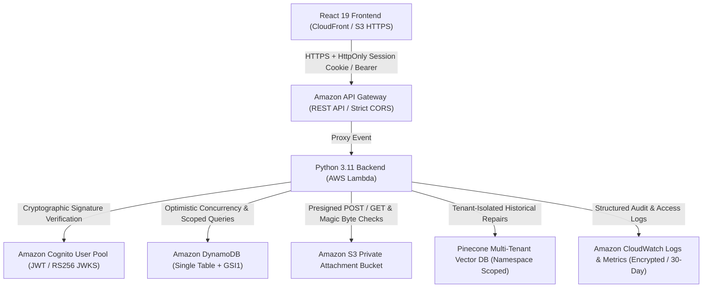

# SmartFix AI — Production Deployment & Security Runbook

This runbook provides the definitive operational and architectural guide for deploying **SmartFix AI** to Amazon Web Services (AWS) in strict accordance with the Phase 1–5 security controls, multi-tenant boundaries, and compliance mandates.

---

## 1. Architectural Architecture Overview



---

## 2. Environment Variables & Secret Configuration

Production strictly forbids local file storage, wildcard CORS origins, default secrets, or unverified identity claims.

| Variable | Required In Production | Allowed Values / Format | Description |
| :--- | :--- | :--- | :--- |
| `ENVIRONMENT` | **Yes** | `production` | Enforces production security checks at startup. |
| `DATA_BACKEND` | **Yes** | `dynamodb` | Rejects file storage; requires DynamoDB. |
| `DYNAMODB_TABLE_NAME` | **Yes** | `SmartFix-Production-core-table` | Primary single-table DynamoDB name. |
| `S3_BUCKET_NAME` | **Yes** | `smartfix-production-attachments-<account>` | Private bucket for ticket photos. |
| `AWS_REGION` | **Yes** | `us-east-1` (or chosen region) | Target deployment region. |
| `COGNITO_USER_POOL_ID` | **Yes** | `us-east-1_xxxxxxxxx` | Cognito User Pool ID. |
| `COGNITO_APP_CLIENT_ID`| **Yes** | `xxxxxxxxxxxxxxxxxxxxxxxxxx` | Cognito App Client ID. |
| `ALLOWED_ORIGINS` | **Yes** | `https://campus.edu,https://admin.campus.edu` | Specific HTTPS domains (no wildcards allowed). |
| `JWT_SECRET` | Optional if Cognito | 64+ character random hex | Backup signing secret for emergency local auth. |
| `PINECONE_API_KEY` | Optional | `pcsk_...` | Vector DB key for historical repair RAG. |
| `GEMINI_API_KEY` | Optional | `AIza...` | Google AI Studio key for vision fault analysis. |

---

## 3. Least-Privilege IAM Execution Policies

Lambda must execute under an isolated IAM role with least-privilege permissions. No wildcards (`*`) are granted on resources.

### DynamoDB Policy (`DynamoDBTableLeastPrivilege`)
```json
{
  "Version": "2012-10-17",
  "Statement": [
    {
      "Sid": "AllowDynamoDBCoreTableActions",
      "Effect": "Allow",
      "Action": [
        "dynamodb:GetItem",
        "dynamodb:PutItem",
        "dynamodb:UpdateItem",
        "dynamodb:DeleteItem",
        "dynamodb:Query",
        "dynamodb:Scan",
        "dynamodb:DescribeTable"
      ],
      "Resource": [
        "arn:aws:dynamodb:us-east-1:123456789012:table/SmartFix-Production-core-table",
        "arn:aws:dynamodb:us-east-1:123456789012:table/SmartFix-Production-core-table/index/*"
      ]
    }
  ]
}
```

### S3 Policy (`S3BucketLeastPrivilege`)
```json
{
  "Version": "2012-10-17",
  "Statement": [
    {
      "Sid": "AllowPrivateS3ObjectActions",
      "Effect": "Allow",
      "Action": [
        "s3:PutObject",
        "s3:GetObject",
        "s3:DeleteObject",
        "s3:HeadObject",
        "s3:AbortMultipartUpload"
      ],
      "Resource": "arn:aws:s3:::smartfix-production-attachments-123456789012/*"
    },
    {
      "Sid": "AllowS3BucketInspection",
      "Effect": "Allow",
      "Action": "s3:ListBucket",
      "Resource": "arn:aws:s3:::smartfix-production-attachments-123456789012"
    }
  ]
}
```

---

## 4. Step-by-Step AWS SAM Deployment Procedure

### Prerequisites
1. Install AWS CLI v2 (`aws --version`) and AWS SAM CLI (`sam --version`).
2. Configure AWS credentials with administrative deployment permissions:
   ```bash
   aws configure
   ```

### Step 1: Validate SAM Template
```bash
sam validate -t template.yaml
```

### Step 2: Build the Serverless Application
```bash
sam build -t template.yaml --use-container
```

### Step 3: Guided Deployment
```bash
sam deploy --guided \
  --stack-name smartfix-production-stack \
  --parameter-overrides \
    Environment=production \
    AppName=smartfix-ai \
    AllowedCorsOrigin=https://campus.edu
```

Record the generated CloudFormation Outputs:
- `ApiEndpoint`: The live API Gateway base URL.
- `CognitoUserPoolId`: The provisioned User Pool ID.
- `CognitoAppClientId`: The client ID for frontend integration.
- `DynamoDBTableName`: The core data table name.
- `S3BucketName`: The private attachments bucket name.

---

## 5. Frontend Production Build & Distribution

### Step 1: Configure Frontend Production Environment
Create `.env.production` in project root:
```env
VITE_API_BASE_URL=https://<api-id>.execute-api.us-east-1.amazonaws.com/production
VITE_COGNITO_USER_POOL_ID=us-east-1_xxxxxxxxx
VITE_COGNITO_CLIENT_ID=xxxxxxxxxxxxxxxxxxxxxxxxxx
VITE_COGNITO_REGION=us-east-1
```

### Step 2: Build and Test Bundle
```bash
npm run build
```

### Step 3: Deploy to S3 + CloudFront CDN
```bash
aws s3 sync dist/ s3://smartfix-frontend-cdn-bucket/ --delete
aws cloudfront create-invalidation --distribution-id <DISTRIBUTION_ID> --paths "/*"
```

---

## 6. Multi-Tenant Onboarding & Seeding Procedure

Organizations cannot be implicitly created in production. To onboard a new institutional tenant:

1. Create the tenant organization item in DynamoDB:
   ```bash
   aws dynamodb put-item \
     --table-name SmartFix-Production-core-table \
     --item '{
       "PK": {"S": "ORG#org_campus_main"},
       "SK": {"S": "METADATA"},
       "id": {"S": "org_campus_main"},
       "name": {"S": "Campus Facilities Operations"},
       "domain": {"S": "campus.edu"},
       "createdAt": {"S": "2026-10-30T12:00:00Z"}
     }'
   ```

2. Provision the initial Master Administrator:
   - Admin accounts **cannot** register via the public API.
   - Provision in Cognito:
     ```bash
     aws cognito-idp admin-create-user \
       --user-pool-id <USER_POOL_ID> \
       --username admin@campus.edu \
       --user-attributes \
         Name=email,Value=admin@campus.edu \
         Name=custom:role,Value=admin \
         Name=custom:org_id,Value=org_campus_main \
         Name=custom:approval_status,Value=Approved \
       --temporary-password "P@ssw0rdSecure2026!"
     ```

---

## 7. Disaster Recovery & Rollback Runbook

### Rollback Strategy
1. **Application Code Rollback**:
   To immediately revert Lambda to the previous known good version:
   ```bash
   aws lambda update-alias \
     --function-name smartfix-ai-production-backend \
     --name live \
     --function-version <PREVIOUS_VERSION>
   ```

2. **DynamoDB Point-in-Time Recovery (PITR)**:
   DynamoDB has Continuous Backups enabled via `PointInTimeRecoveryEnabled: true`. To restore a damaged table to an earlier minute:
   ```bash
   aws dynamodb restore-table-to-point-in-time \
     --source-table-name SmartFix-Production-core-table \
     --target-table-name SmartFix-Production-core-table-restored \
     --restore-date-time 2026-10-30T22:00:00.000Z
   ```

3. **CloudWatch Alarm Verification**:
   Monitor the following production alarms:
   - `5xxErrorRateAlarm`: Triggers if API Gateway 5xx rate > 1% over 5 minutes.
   - `LambdaThrottleAlarm`: Triggers if Lambda throttles > 0.
   - `S3UploadFailureAlarm`: Triggers on upload 4xx/5xx spikes.

---

## 8. Security Hardening Checklist Before Final Sign-Off

- [x] S3 bucket blocks all public ACLs and bucket policies (`BlockPublicAcls: true`).
- [x] Uploaded attachments undergo server-side magic byte inspection (JPEG/PNG/WebP).
- [x] Files exceeding 5 MB rejected at S3 policy boundary and server-side verification.
- [x] Presigned view downloads verify ticket ownership and tenant boundaries.
- [x] HttpOnly, Secure, SameSite=Strict cookies protect session state.
- [x] Double-submit CSRF cookie tokens (`X-CSRF-Token`) validated on state-changing requests.
- [x] Dynamic rate limiting blocks credential stuffing and upload abuse.
- [x] DynamoDB optimistic concurrency rejects conflicting simultaneous updates with HTTP 409.
- [x] RAG knowledge store enforces strict multi-tenant partition filters.
- [x] Production application startup fails if `DATA_BACKEND != 'dynamodb'`.
