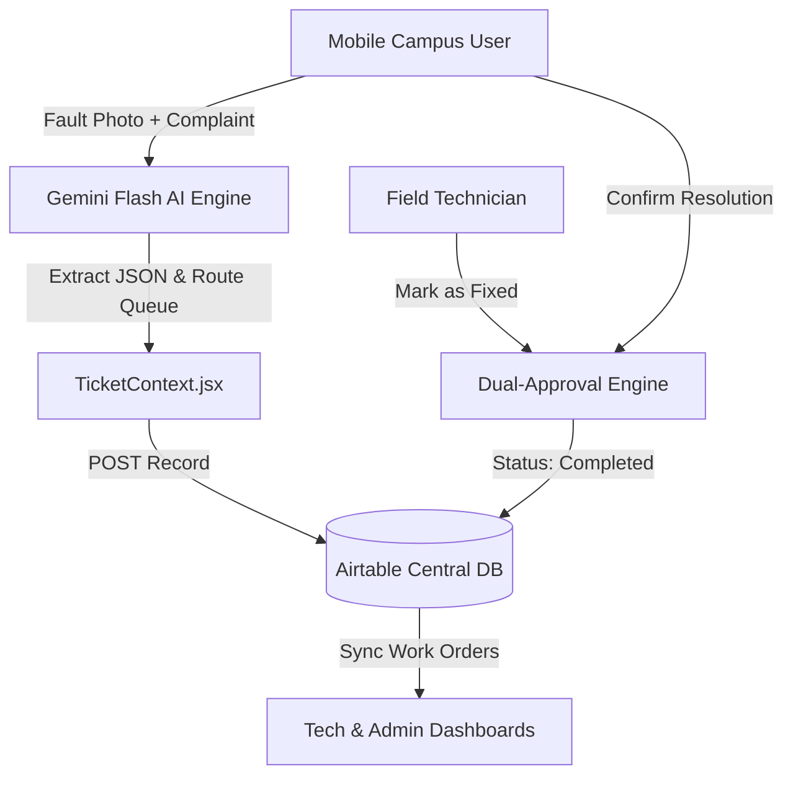

# SmartFix AI (FixFlow AI)

> AI-Powered Campus Maintenance & Work Order Dispatching System with Dual-Approval Resolution and Gated Authentication.

SmartFix AI is a modern facilities management platform built with **React 19, Vite, and Tailwind CSS**. It features multimodal Gemini AI for automatic fault extraction and queue routing, live **Airtable** central database synchronization, a **Dual-Approval Closure Engine**, and an **Admin Gated Authentication** system.

---

## 🌟 Key Features

- **Multimodal AI Chief Engineer**: Snap a photo with your mobile camera and enter a complaint. AI extracts title, category (Plumbing, Electrical, HVAC, IT, General), priority, location, and routes to the appropriate technician queue.
- **Dual-Approval Closure Engine**: Work orders cannot be closed unilaterally; resolving an issue requires two-party confirmation:
  1. Field Technician marks work order as **"Mark as Fixed"** -> status becomes `Pending User Verification`.
  2. The reporting campus user verifies the physical repair and clicks **"Confirm Issue Resolved"** -> status becomes `Completed`.
- **Gated Authentication (Admin Approvals)**:
  - New user and technician sign-ups are registered with `Pending` status.
  - Access is strictly blocked until an Administrator reviews and approves the account in the **Pending Approvals** queue.
- **Live Airtable Database Sync**: Syncs with central Airtable Base (`app32PCGpVp4lBamC`), enabling seamless interoperability between web operators and voice bots.
- **Mobile-First Responsive UI**: Native rear-camera capture (`capture="environment"`), touch controls, and desktop views.

---

## 🏗️ Architecture



---

## 🚀 Getting Started

### Prerequisites

- [Node.js](https://nodejs.org/) (v18 or higher recommended)
- [npm](https://www.npmjs.com/)

### Installation

1. Clone the repository:
   ```bash
   git clone https://github.com/Abd8532/SmartFix-AI.git
   cd SmartFix-AI
   ```

2. Install dependencies:
   ```bash
   npm install
   ```

3. Set up environment variables:
   Copy `.env.example` to `.env` and fill in your keys:
   ```bash
   cp .env.example .env
   ```
   ```env
   VITE_AIRTABLE_PAT=your_airtable_personal_access_token
   VITE_GEMINI_API_KEY=your_gemini_api_key
   ```

4. Start development server:
   ```bash
   npm run dev
   ```

5. Build for production:
   ```bash
   npm run build
   ```

---

## 👥 Demo Accounts for Testing

| Role | Email | Password | Status |
|---|---|---|---|
| **Administrator** | `admin@campus.edu` | `admin123` | Master Admin (Pre-Approved) |
| **Campus User** | `alex@campus.edu` | `password123` | Pre-Approved |
| **Field Technician** | `tech@campus.edu` | `password123` | Pre-Approved |
| **Pending User (Testing)** | `jordan@campus.edu` | `password123` | Pending Approval |

---

## 🧪 Testing

Run the automated end-to-end actuation test suite:
```bash
node test-app.cjs
```

---

## 📄 License

MIT
